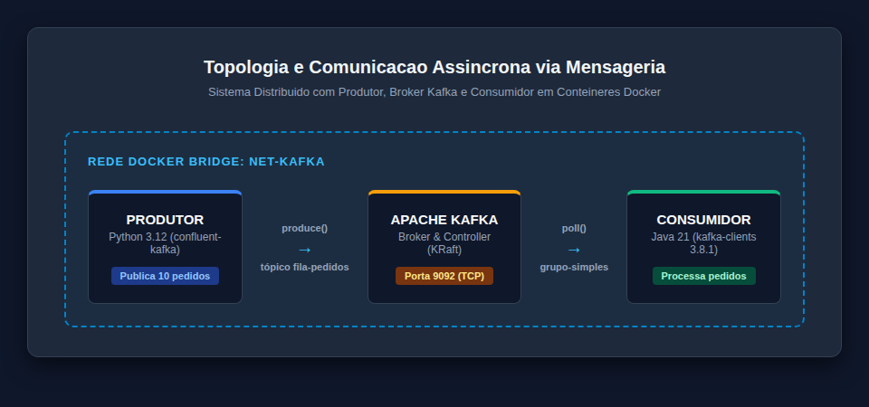

# Aplicacao Produtor e Consumidor usando Apache Kafka - Fila de Mensagens

Projeto desenvolvido para a disciplina de Sistemas Distribuidos, implementando o padrao de comunicacao assincrona Pub/Sub (Publish-Subscribe) utilizando Apache Kafka no modo KRaft (sem Zookeeper), com servicos conteinerizados via Docker e Docker Compose.

---

## 1. Visao Geral da Arquitetura

O sistema e composto por tres elementos centrais conectados em uma rede bridge dedicada:

- **Broker de Mensagens (Apache Kafka 3.9.1)**: Executando em modo KRaft (Kafka Raft Metadata Mode), responsavel por receber, persistir e ordenar as mensagens no topico `fila-pedidos`.
- **Produtor de Pedidos (Python 3.12)**: Aplica a biblioteca `confluent-kafka` para serializar e despachar 10 pedidos culinarios sequenciais ao broker, recebendo confirmacoes de entrega (callbacks de delivery report).
- **Consumidor de Pedidos (Java 21)**: Utiliza a biblioteca oficial `kafka-clients` (3.8.1) para subscrever o topico `fila-pedidos`, operando em loop de polling contínuo para processar cada mensagem recebida.

---

## 2. Demonstracao de Execucao

### Inicializacao do Broker Apache Kafka
Exibicao do conteiner do Kafka ativo e ouvindo conexoes na porta 9092.


---

### Execucao do Produtor (Python)
Envio ordenado dos 10 pedidos para o topico `fila-pedidos` com confirmacao do offset de cada mensagem gravada no broker.


---

### Execucao do Consumidor (Java)
Processamento e exibicao em tempo real de cada pedido retirado da fila pelo consumidor Java pertencente ao grupo consumidor `grupo-simples`.


---

### Topologia de Comunicacao
Visao geral do fluxo assincrono dos dados e do isolamento por rede Docker.



---

## 3. Imagens Publicadas no Docker Hub

As imagens de cada servico foram compiladas e estao disponiveis publicamente no Docker Hub:

| Servico | Imagem Docker Hub | Versao |
| :--- | :--- | :--- |
| Produtor (Python) | `tobiasrafaelrosa/kafka-fila-produtor:1.0` | `1.0` / `latest` |
| Consumidor (Java) | `tobiasrafaelrosa/kafka-fila-consumidor:1.0` | `1.0` / `latest` |

---

## 4. Estrutura do Projeto

```text
ProjetoSistemasDistribuidos/
├── docker-compose.yml          # Orquestracao dos servicos (Kafka, Consumidor e Produtor via Docker Hub)
├── .gitignore                  # Arquivos ignorados pelo Git
├── README.md                   # Documentacao completa da solucao
├── docs/
│   └── screenshots/            # Evidencias visuais de execucao dos servicos
├── Produtor/
│   ├── Dockerfile              # Imagem base Python 3.12-slim com confluent-kafka
│   └── produtor.py             # Script de publicacao de pedidos no topico
└── Consumidor/
    ├── Dockerfile              # Multi-stage build com Maven 3.9 e Eclipse Temurin 21
    ├── pom.xml                 # Gerenciamento de dependencias (kafka-clients 3.8.1)
    └── src/main/java/br/edu/ifsp/pep/consumidor/
        └── Consumidor.java     # Classe principal de escuta e consumo de mensagens
```

---

## 5. Como Executar

### Pre-requisitos
- Docker instalado (versao 20.10 ou superior)
- Docker Compose instalado

---

### Execucao Completa via Docker Compose (Docker Hub)

Na raiz do projeto, suba todos os servicos (o Kafka, o Consumidor e o Produtor serao inicializados utilizando as imagens do Docker Hub):

```bash
docker compose up -d
```

Verifique o status dos conteineres (o Kafka e o Consumidor permanecem ativos; o Produtor executa o envio dos 10 pedidos e finaliza com status 0):

```bash
docker compose ps -a
```

Visualize os logs do Consumidor (Java) processando os pedidos:

```bash
docker compose logs -f consumidor
```

Visualize os logs do Produtor (Python) com o envio e confirmacao dos 10 pedidos:

```bash
docker compose logs produtor
```

Caso queira disparar novamente o lote de 10 pedidos pelo produtor:

```bash
docker compose start produtor
```

---

### Execucao Individual dos Conteineres (Opcional)

Caso prefira executar os conteineres manualmente em terminais separados via `docker run`:

1. Consumidor (Java):
```bash
docker run --rm -it --network net-kafka tobiasrafaelrosa/kafka-fila-consumidor:latest
```

2. Produtor (Python):
```bash
docker run --rm -it --network net-kafka tobiasrafaelrosa/kafka-fila-produtor:latest
```

---

### Encerrar o Ambiente

Para parar todos os conteineres e desmontar a rede:

```bash
docker compose down
```
